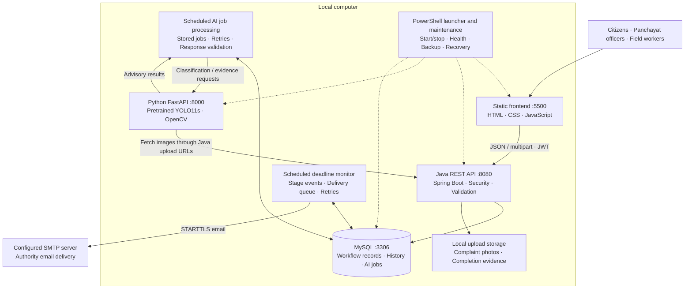
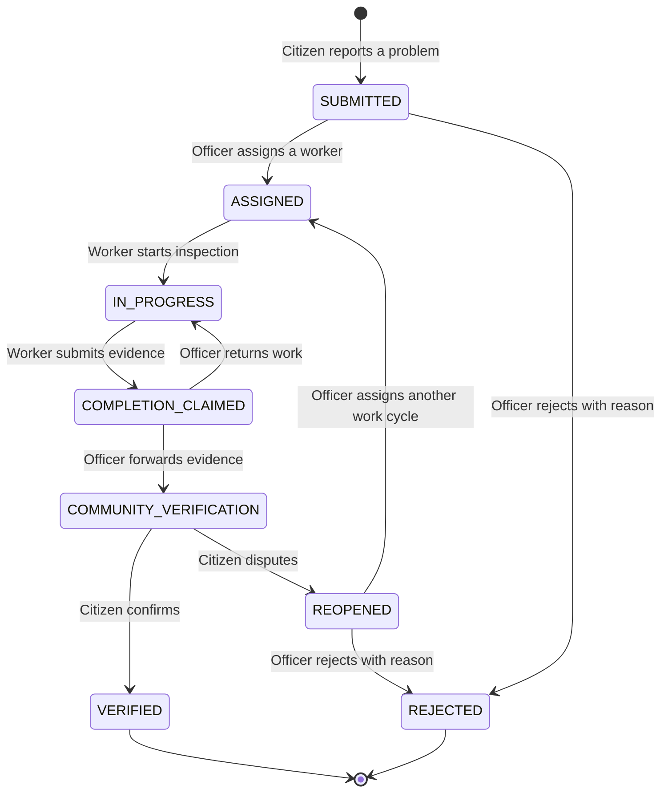
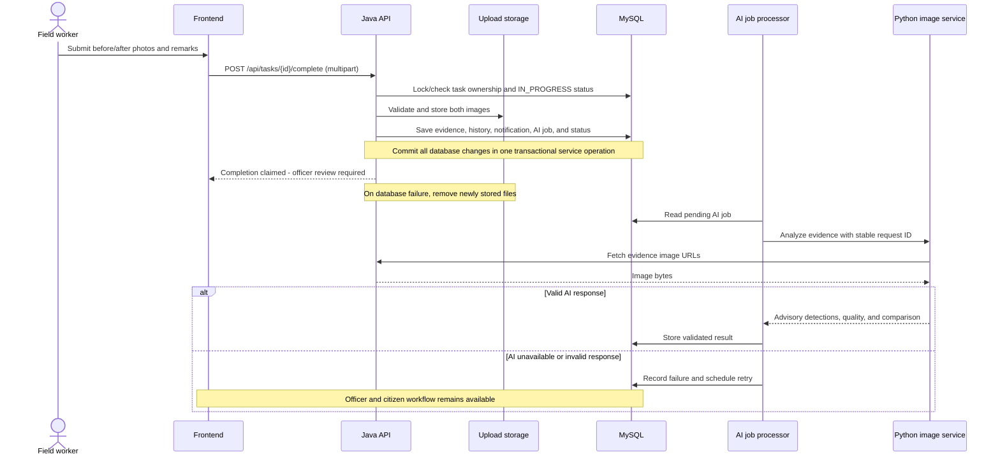
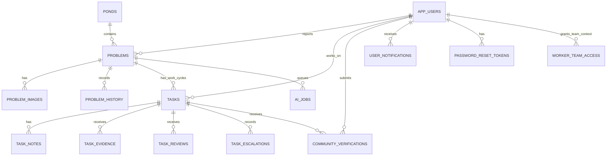
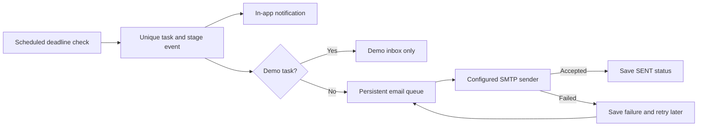
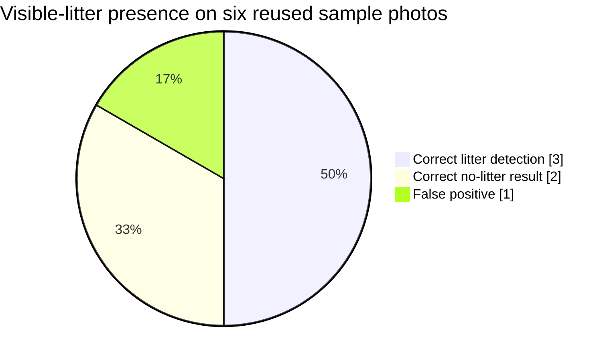

<div align="center">

# JALACHAYA

### Community pond reporting, field work, and public accountability

A UHV college project connecting citizens, Panchayat officers, and field workers through a traceable complaint-to-verification workflow.


[Quick start](#quick-start) · [Architecture](#architecture) · [Data flow](#data-flow) · [Pond Recovery Index](#pond-recovery-index) · [Email escalation](#automatic-email-escalation) · [Demo](#judge-demonstration) · [Deployment](#deployment) · [Verification](#verification-and-project-statistics)

</div>

---

## Overview

Jalachaya gives pond complaints a complete, reviewable record: a resident reports a problem, an officer assigns work, a field worker uploads evidence, and residents confirm or dispute the result. Public pages show pond status, recent activity, and verified before/after examples.

The frontend calls a Java REST API backed by MySQL. A separate Python service provides advisory image analysis using an existing pretrained litter detector, without local model training. Human review controls complaint outcomes.

**Current scope:** a working full-stack installation with real database persistence, three role-specific portals, local launcher tools, and public Render cloud deployment.

### Features by role

| Role | Capabilities |
|---|---|
| **Citizen** | Register, report pond issues with photos, follow complaint history, browse pond status inside the portal, confirm or dispute completed work, read notifications |
| **Panchayat officer** | Manage ponds and photos, review complaints, assign workers and deadlines, review completion evidence and AI advice, return work, escalate overdue tasks, view counts and analytics |
| **Field worker** | View assigned inspections, start work, record notes/photos, submit before/after evidence, follow review outcomes |
| **Public visitor** | Browse registered ponds, public complaint timelines, recent activity, and verified result highlights |

## Architecture



### Service boundaries

- **Frontend:** renders public pages and authenticated portals; role selection, forms, dialogs, responsive layouts, and periodic refreshes use the real API.
- **Java:** owns authentication, permissions, complaint transitions, assignments, evidence records, notifications, dashboard calculations, and AI job persistence.
- **MySQL:** stores application records and history. Flyway applies schema changes; Hibernate validates the schema on startup. Java services also use JDBC for workflow queries and updates.
- **Filesystem:** stores uploaded image bytes; database records hold their paths. Database rollback is paired with cleanup of newly stored files when completion fails.
- **Python:** analyzes images and returns advisory results. It does not decide whether a complaint is resolved.
- **Deadline monitoring:** records overdue stages and inbox notifications, queues emails to configured recipients, and tracks SMTP attempts. Demo events stay inside the demo inbox.
- **Local operations:** coordinates application startup, checks services, encrypts saved local credentials for the Windows user, and manages database/upload backups.

## Tech stack

| Layer | Technology | Purpose |
|---|---|---|
| Frontend | HTML5, CSS3, vanilla JavaScript | Static pages, role portals, forms, tables, and dialogs |
| Visuals | SVG and CSS animations | Pond illustrations, water dividers, and responsive animated footer |
| Backend | Java 17, Spring Boot **3.5.16**, Maven | REST API and business rules |
| Authentication | Spring Security, OAuth2 Resource Server/JWT, password hashing | Role and ownership checks, token authentication |
| Persistence | MySQL, Spring JDBC, Spring Data JPA/Hibernate | Persistent records, queries, and schema validation |
| Migrations | Flyway Core + MySQL support | Ten versioned schema migrations |
| Email alerts | Spring Boot Mail, Jakarta Mail, SMTP with STARTTLS | Automatic deadline escalation, persisted delivery status, and retries |
| Alternative database | H2 | Default standalone backend database and isolated integration tests |
| Image API | Python **3.11+**, FastAPI, Uvicorn, Pydantic | Request validation and image analysis endpoints |
| Image processing | OpenCV, NumPy, Pillow | Image quality and before/after comparison |
| Object detection | Ultralytics, pretrained TACO YOLO11s | Advisory litter detections without local training |
| Operations | PowerShell, CMD, Windows DPAPI, MySQL tools | Launcher, encrypted local credentials, diagnostics, backups, and recovery |
| Verification | JUnit/Spring Boot tests, pytest, Playwright/Chromium | API, outage, workflow, service, and browser checks |

Python dependency ranges are recorded in [requirements.txt](ai-service/requirements.txt); Java dependencies are managed in [pom.xml](backend/pom.xml). Model weights are pinned and checksum-verified by [setup_model.py](ai-service/setup_model.py).

## Data flow

### Complaint lifecycle



Every transition is permission-checked and recorded in history. Reopened complaints retain earlier evidence and task records. The dashboard's **Pond Recovery Index** is calculated from complaint stages and priority; it is a workflow measure, not a water-quality measurement.

### Completion submission and AI processing



**Retry behavior:** completion uses one multipart request with `beforeImage`, `afterImage`, and `remarks`. A repeated completion receives `409` without duplicate evidence. AI requests run separately through stored jobs and retries; AI failure does not block human verification.

### Main database relationships

The diagram shows selected relationships across the 18 application tables; the SQL migrations define the complete columns, indexes, and constraints.



## Pond Recovery Index

The **Pond Recovery Index (PRI)** summarizes the progress of a pond's complaints on a **0–100 workflow scale**. Priority weights give urgent complaints more influence. Only verified complaints receive full credit.

| Complaint stage | Progress contribution |
|---|---:|
| Submitted | 0% |
| Reopened | 10% |
| Assigned | 20% |
| In progress | 40% |
| Completion claimed | 60% |
| Community verification | 80% |
| Verified | 100% |

Priority weights: **Low = 1 · Medium = 2 · High = 3 · Urgent = 4**.

```text
PRI = round(100 × Σ(priority weight × stage fraction) / Σ(priority weight))
```

For example, a verified Medium complaint and an in-progress High complaint produce `round(100 × (2 × 1 + 3 × 0.4) / (2 + 3)) = 64`.

- Rejected complaints are excluded. No applicable complaints means an unavailable index, not a fabricated score.
- The result is capped at **99** until **every included complaint is verified**, so rounding cannot imply complete resolution early.
- Reopening a complaint lowers its contribution; the value is recalculated from database records.
- View it in public pond status, pond details, and the officer analytics panel.

**Interpretation:** PRI measures recorded work and verification progress. It does not measure water chemistry, ecological recovery, or whether water is safe to use.

## Automatic email escalation

A Java scheduler checks active assigned/in-progress tasks every minute. When a deadline stage is reached, it records history, creates an in-app notification, and queues the applicable email. The officer configures the recipient addresses; the application does not discover or independently contact government offices.

| Level | Default trigger | Recipient / action |
|---|---|---|
| **L0 — Assigned** | Task assigned | Existing assignment history and notification |
| **L1 — Reminder** | Within 24 hours before deadline | Assigned worker reminder |
| **L2 — Overdue** | Deadline reached | Panchayat alert |
| **L3 — Higher authority** | Still unresolved 24 hours after deadline | Configured higher-authority alert |
| **L4 — Inspection request** | Still unresolved 48 hours after deadline | Configured manual-inspection contact |



### Configure and inspect delivery

1. Configure a private sender through **[setup-email.cmd](setup-email.cmd)** or the six SMTP settings in an ignored `backend/.env` file. The sender can use Gmail with an app password and STARTTLS on port 587.
2. Stop and restart the app to load changed SMTP settings.
3. Log in as a real officer and open **Overview → Automatic deadline alerts → Authority email recipients and setup**.
4. Save the Panchayat, higher-authority and inspection recipient addresses, then use **Send test email**.

Passwords and private recipient configuration are not published in this repository.

**Delivery behavior:** events and attempts persist in MySQL, missing configuration remains visible, and failed email sends retry with backoff. Demo accounts never send external emails. After downtime, the monitor catches up overdue stages; completed or inactive field tasks stop pending alerts. L4 sends an inspection request—it does not conduct an inspection.

**Operational limits:** Java must remain running for timely checks, and email needs Internet access. `SENT` means the SMTP server accepted the message; it does not prove inbox arrival or acknowledgment. A process crash after SMTP acceptance but before the database update can cause a duplicate on retry.

## Quick start

### 1. Install prerequisites

- **Windows + PowerShell**, Java **17**, Python **3.11+**, MySQL Server and command-line tools.
- **Maven on PATH** for a fresh checkout. The developer's ignored `backend/.tools/apache-maven-3.9.9/` is also supported when present; it is not included in Git.
- Internet access for first-time Python dependency and pretrained-model downloads.
- Free local ports **5500**, **8080**, and **8000**. MySQL normally uses **3306**.

```powershell
git clone https://github.com/anugrahks19/Jalachaya.git
cd Jalachaya
java -version
python --version
mvn -version
```

### 2. Prepare MySQL once

Run this in the MySQL command-line client as an administrator. Replace the example password locally with your own private password. If the app user already exists, use the existing password or change it with `ALTER USER`.

```sql
CREATE DATABASE IF NOT EXISTS jalachaya
    CHARACTER SET utf8mb4 COLLATE utf8mb4_unicode_ci;
CREATE USER IF NOT EXISTS 'jalachaya'@'localhost'
    IDENTIFIED BY 'REPLACE_WITH_YOUR_PRIVATE_PASSWORD';
GRANT ALL PRIVILEGES ON jalachaya.* TO 'jalachaya'@'localhost';
```

### 3. Start the application

Double-click **[start-jalachaya.cmd](start-jalachaya.cmd)**, or run:

```powershell
.\start-jalachaya.cmd
```

The launcher checks/starts MySQL, verifies the database login, prepares Python dependencies/model weights, applies database migrations through Java startup, starts the application services, and opens **http://127.0.0.1:5500/index.html**.

On first run, enter your MySQL application password and private officer/worker passwords in the local prompts. Saved credentials are encrypted for your Windows account in ignored `.runtime/credentials.json`; existing account passwords are not overwritten. If Windows denies permission to start MySQL, start it in Windows Services or run the launcher as administrator.

| Service | Local address |
|---|---|
| Website | http://127.0.0.1:5500/index.html |
| Java health check | http://127.0.0.1:8080/api/health |
| Python API documentation | http://127.0.0.1:8000/docs |

Stop launcher-owned application processes with `stop-jalachaya.cmd`. MySQL remains running. Logs are under `.runtime/`.

### Configuration

| Setting | Purpose |
|---|---|
| `DB_URL`, `DB_USERNAME`, `DB_PASSWORD` | Java database connection; the launcher configures MySQL |
| `JWT_SECRET` | Private JWT signing secret; at least 32 UTF-8 bytes |
| `BOOTSTRAP_OFFICER_*`, `BOOTSTRAP_WORKER_*` | Optional initial staff accounts |
| `FRONTEND_ORIGINS` | Allowed browser origins; defaults include localhost/127.0.0.1 on port 5500 |
| `UPLOAD_DIR` | Evidence and complaint image storage directory |
| `AI_ENABLED`, `AI_SERVICE_URL`, `AI_BACKEND_URL` | AI integration switch and private service/image URLs |
| `AI_TIMEOUT_MS`, `AI_POLL_MS` | AI request timeout and job polling interval |

[backend/.env.example](backend/.env.example) is a reference file. Spring Boot does **not** automatically load it. Starting Java without launcher database settings uses persistent H2 under `backend/data/`; the normal launcher uses MySQL.

## Judge demonstration

The launcher explicitly enables three demo accounts with real Java authentication and MySQL records. Select a role on the login page, use its demo helper, then click **Log in**.

| Role | Email | Demo password |
|---|---|---|
| Citizen | `citizen@judges.invalid` | `JudgeCitizen123!` |
| Panchayat officer | `officer@judges.invalid` | `JudgeOfficer123!` |
| Field worker | `worker@judges.invalid` | `JudgeWorker123!` |

These intentionally published demo credentials are for the local presentation. Judge mode is disabled by default when Java runs separately. Private bootstrap credentials are excluded from Git.

| Seeded example | Count |
|---|---:|
| Role accounts | 3 |
| Ponds | 3 |
| Complaints | 9 |
| Represented complaint stages | 8 |
| Worker tasks | 7 |
| Verified public result examples | 2 |

Seed data is labelled **[JUDGES DEMO]**, created idempotently, and preserved after subsequent user actions. Demo records are visible only while authenticated with a demo account; normal accounts and anonymous public views use real data. Counts describe the initial demo fixture, not live usage or real environmental outcomes. Example before/after scenes are presentation data, not measured cleanups.

### Presentation route

1. **Citizen:** inspect existing complaints or submit a new report with a pond name, ward/locality, and optional photos/coordinates. The pond does not need prior officer registration.
2. **Officer:** assign the report to the demo worker with a future deadline and priority; show dashboard counts and the seeded overdue task.
3. **Worker:** start inspection, add a note, and submit before/after evidence with remarks.
4. **Officer:** inspect evidence and AI advice; forward for community verification or return the work.
5. **Citizen:** confirm to reach `VERIFIED`, or dispute with a reason to reach `REOPENED`.
6. **Public view:** show updated pond status and verified highlights. Role notifications and lists refresh periodically, normally every 20 seconds.

Citizen, officer, and worker pond browsing stay inside their respective dashboards. The local field roster has five numbered teams with named leads; workload counts are displayed separately from team numbers. Field worker login includes a team selector. The configured local shared worker account can access all five real teams through explicit MySQL grants, with separate signed sessions per selected team. Registration uses two sliding steps with preserved Back navigation. Auth layouts and animated pond illustrations adapt to desktop and phone screens.

## AI capabilities and evaluation

The Python service uses pinned **TACO YOLO11s** litter weights without local training. It reports possible litter objects, image brightness/sharpness, before/after detection counts, and visible pixel change, with alignment when possible. Java validates AI responses before storing them for officer review.

**AI advice never automatically resolves a complaint.** The citizen's reported category remains authoritative for workflow routing, and officer/citizen decisions determine completion.

### Six-photo demonstration sanity check



| Measurement | Result |
|---|---:|
| Reviewed sample photos | 6 |
| True positives / true negatives | 3 / 2 |
| False positives / false negatives | 1 / 0 |
| Image-presence agreement | 5/6 (83.3%) |
| Precision / recall on this set | 75% / 100% |

This reused demonstration set is **not a held-out field benchmark** and does not establish product accuracy. Object boxes have not been independently annotated. The false positive occurred on a clean-looking scene despite a high model score. More labelled local pond photos are needed to assess field performance.

The system does not measure water chemistry, sewage safety, smell, algae, or biological health. Visible pixel change or fewer detections cannot prove waste removal. Advisory findings require human officer review.

## Verification and project statistics

### Repository snapshot

Counts checked against the source on **23 October 2026**; they describe implementation size, not user adoption or performance.

| Item | Count |
|---|---:|
| Source files in this snapshot | 184 |
| HTML pages | 16 |
| Java application source files | 46 |
| Java test classes / declared tests | 13 / 22 |
| Python service test functions | 6 |
| Flyway migrations / application tables | 10 / 18 |
| User roles / complaint states | 3 / 8 |
| Implementation phases | 6 implemented |

### Latest verification

| Check | Result / scope |
|---|---|
| Java suite, rerun 23 October 2026 | **22 tests: 21 passed, 1 skipped, 0 failures/errors**; the MySQL smoke test is conditional |
| Python service suite, rerun 23 October 2026 | **6 passed** |
| Real MySQL smoke test | Passed through Flyway **V10** on 23 October 2026; separate from the standard suite above |
| Real Java + Python + MySQL workflow | Previously reached `VERIFIED`; officer AI output checked in the browser |
| Authentication and portals | Three role logins, notifications, role mismatch rejection, and citizen pond dialogs checked |
| Responsive auth pages | Six viewport sizes from **320×568** to **1920×900** checked; registration Back/validation and real registration checked |
| Local recovery | One-time reset, expiry/replay checks, password change, and old-session rejection verified |
| Backup/restore | Dump/file hashes checked; restore verified on a disposable MySQL instance with matching row counts |
| Launcher recovery | Stale/reused PID safety, repeated starts, and frontend recovery verified |

These are functional checks, not load-test or availability guarantees. Test counts reflect fresh automated test runs.

### Repeat checks

```powershell
# From backend/; Maven must be installed or use your local Maven path.
mvn test

# From the repository root.
python -m pytest ai-service/tests -q
python ai-service/evaluate_model.py
.\verify-mysql-workflow.cmd
```

`verify-mysql-workflow.cmd` exercises the live MySQL workflow and browser, then removes its temporary test records. Development browser checks require Playwright and Chromium; normal startup does not. The named-pond/demo-isolation integration test also checks typed names, optional coordinates, shared-name separation, and rejected cross-scope actions. The live browser/workflow regression is in `tests/named-ponds-scope-browser.py` and requires locally configured private test environment variables.

The conditional MySQL test can also be run with [backend/run-mysql-smoke.ps1](backend/run-mysql-smoke.ps1).

## Local operations and security

| Command | Purpose |
|---|---|
| `start-jalachaya.cmd` | Start services and open the website |
| `stop-jalachaya.cmd` | Stop launcher-owned processes safely |
| `check-jalachaya.cmd` | Check frontend, Java, database, AI model, and latest backup |
| `backup-jalachaya.cmd` | Pause application services, back up MySQL/uploads, verify, and restart |
| `recover-account.cmd` | Issue a private, one-time password reset link for an existing account |
| `restore-jalachaya.cmd` | Verify and restore a backup after explicit `RESTORE` confirmation |
| `verify-mysql-workflow.cmd` | Exercise the live end-to-end workflow |

- JWT authentication, role checks, and record ownership protect application actions; sensitive citizen views mask staff/reporter details as specified by the API contract.
- Completion validates ownership and state, protects against duplicate evidence, and cleans up new files on database failure.
- Password reset links expire after **30 minutes**, are single-use, and invalidate existing sessions after a password change. Issuance requires local operator access.
- The launcher creates the first daily startup backup when an existing schema is present. Backups/checksums are private under `.runtime/backups/`; keep a copy on another drive.
- A `COMPLETE.json` marker means backup verification passed, not that the working database was restored. Restore testing used a disposable database.
- The frontend server blocks backend/private runtime files and old mock scripts. Unused `js/mock/` sources remain as reference files and are not loaded or used as fallback.
- Credentials, local databases, uploads, logs, downloaded tools/model weights, and generated builds are excluded from Git. Upload storage and databases must be backed up together.

## Project structure

```text
Jalachaya/
├── index.html, login.html, register.html, pond.html
├── citizen/                    Citizen dashboard, reporting, verification, ponds
├── panchayat/                  Officer overview, complaints, pond management
├── worker/                     Field worker inspection dashboard
├── css/                        Shared, dashboard, auth, and motion styles
├── js/                         API client, auth, UI helpers, page logic, SVG scenes
├── assets/                     Decorations and labelled sample photos
├── backend/
│   ├── src/main/java/          Spring Boot API and application services
│   ├── src/main/resources/    Configuration and Flyway
│   ├── src/test/java/          Integration tests
│   ├── Dockerfile              Render / container build
│   └── pom.xml                 Java dependencies and Maven build
├── ai-service/                 FastAPI app, model setup, evaluation, service tests
├── render.yaml                 Render deployment blueprint
├── tests/                      Browser and launcher regression checks
├── start-jalachaya.cmd         Local entry point
└── *-jalachaya.*, verify-*     Maintenance and verification tools
```

## Deployment

### Local Development
Double-click `start-jalachaya.cmd` or run `.\start-jalachaya.ps1` from PowerShell. This starts the MySQL database, Spring Boot backend on port 8080, FastAPI AI service on port 8000, and static frontend on port 5500.

### Public Cloud (Render)
This repository includes a native [render.yaml](render.yaml) blueprint and [backend/Dockerfile](backend/Dockerfile):
1. In [Render](https://dashboard.render.com), click **New +** → **Blueprint**.
2. Select your repository `anugrahks19/Jalachaya`.
3. Render automatically provisions:
   - **`jalachaya-backend`**: Dockerized Spring Boot Web Service (configured for Render free tier).
   - **`jalachaya`**: Static Site for the citizen, officer, and worker portals.

---

<div align="center">

**JALACHAYA · Pond reporting with evidence, review, and community participation**

</div>
